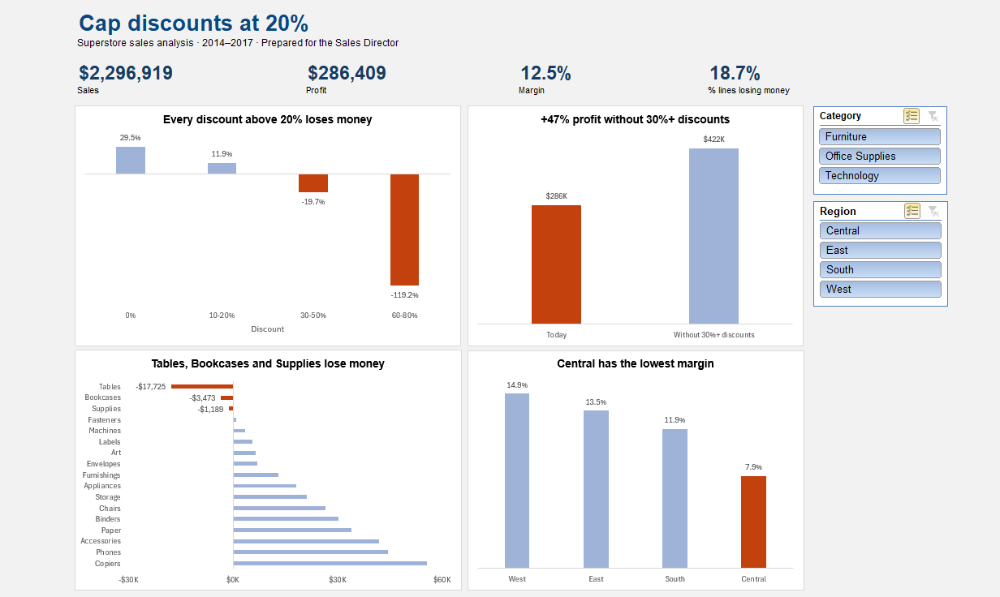

# Superstore Sales Analysis
## Overview
Sales analysis of a fictional US retailer that sells furniture, office supplies and technology, framed as if I were advising the Sales Director. Almost 1 in 5 sales is a loss. Superstore made $2.30M in sales and $286K in profit, a 12.5% margin.

**Recommendation:** cap discounts at 20%, starting with Tables and the Central region. Sales with discounts of 30% or more lose $135K; without them, profit would be 47% higher.

---

## Author
**Belén Micó Velarde**
[LinkedIn](https://www.linkedin.com/in/belenmicovelarde)

---
## Tools
- **Excel** --> Power Query (import, profiling, cleaning, helper columns), pivot tables, pivot charts and slicers

---

## Business Problem
- **Client:** Sales Director, who owns the sales team and the discount policy
- **Pain:** They can see total sales and profit, but not which products, regions or discounts make money and which ones lose it.
- **Decision:** Where to change the discount policy, and which products to fix or drop, to increase profit without losing too many sales.

---

## Business Questions & Metrics
1. How do discounts affect sales and profit? And how much of our sales is made with high discounts?
2. Which products lose money, and how much?
3. Which regions are profitable, and which are not?
4. Which customer segments are most and least profitable?

| Role | Metric | Why |
|---|---|---|
| Primary | Profit ($) | 	Shows where money is made or lost |
| Supporting | Profit margin (%) and Sales ($) | Margin compares groups of different sizes fairly; sales shows volume |
| Diagnostic | Margin by discount level, sub-category, region and segment | Explains why some groups lose money |

---

## Key Findings
1. Almost 1 in 5 **sales** loses money.
2. **The bigger the discount, the worse the margin**: every discount group above 20% loses money.
3. Without sales with **discounts of 30% or more**, profit would be 47% higher, even if all those sales were lost.
4. **Only 3 of 17 sub-categories lose money.** Tables loses the most, because 43% of its sales carry high discounts.
5. **Central is the weakest region:** 7 of its 17 sub-categories lose money, and it has the highest share of high-discount sales.
6. **Customer segments** show no meaningful difference (11.5%–14.0% margin).

---

## Interpretation
Superstore has a 12.5% margin, but **almost 1 in 5 sales loses money.** The main driver is **discounting:** the bigger the discount, the worse the margin, and every sale with a discount of 30% or more loses money overall (−$135K). Even if all those sales were lost, **profit would rise by 47%.**

**Only Tables, Bookcases and Supplies lose money,** with margins between −2.5% and −8.6%. 43% of Tables’ sales carry discounts of 30–50%. Most sub-categories offset their high-discount losses with profitable low-discount sales; Tables can’t. Supplies is different: it never gets high discounts, so its problem is likely the margin between cost and selling price, not discounting.

No **region** loses money, but **Central underperforms:** 7 of its sub-categories lose money, against 2–3 elsewhere, and it makes the most sales with high discounts (25.8%). West has the best margin and only 2.4% of high-discount sales. Discounts explain most of the gap between regions, though not all of it.

**Segments** perform similarly, so they are **not a priority.**

---

## Recommendation
**Cap discounts at 20%,** starting with Tables and the Central region.

**Where to start:**
1. Tables: the biggest loss (−$17.7K) and the highest share of high discounts (43%). Without them, Tables is profitable.
2. Central: the region with the most high-discount sales and the most losing sub-categories.

**How to measure it:** Apply the cap in Central for one quarter and compare its profit and sales with the other regions. If profit rises and sales don’t drop much, roll it out to everyone.

**Separately:** review Supplies’ prices or supplier costs. Its problem isn’t discounts.

**What not to do:**
- Don’t remove all discounts. Discounts up to 20% are still profitable (11.9% margin).
- Don’t drop Tables. It makes money when it isn’t heavily discounted.
- Don’t target segments. They show no meaningful difference.

---

## Dashboard
Built in Excel with pivot charts and slicers (Region, Category) that update the KPI cards and charts.



---
  
## Approach

- **Data cleaning (Power Query).** Every step is recorded in Power Query and documented in the Notes sheet. I checked that the US-format dates were read correctly, removed 1 exact duplicate row, restored the leading zero in 449 postal codes, and found that 32 Product IDs were shared by two different products, so products were analysed by name instead.
- **Helper columns.** I added discount groups (0%, 10–20%, 30–50%, 60–80%), implied cost (sales minus profit), and a flag for order lines that lose money.
- **Margin calculated correctly.** Margin is always total profit divided by total sales (a calculated field in the pivot tables), never an average of row margins, so large sales weigh more than small ones.
- **Checking each finding.** I crossed discounts with sub-categories and regions to see whether losses were really driven by discounts. This showed that Tables loses money because of high discounts, while Supplies loses money for a different reason.

**Calculations**

```
Margin           (pivot calculated field) = Profit / Sales
Cost             (Power Query)            = Sales - Profit
Original Price   (Power Query)            = Sales / (1 - Discount)
Discount Amount  (Power Query)            = Original Price - Sales
Discount group   (Power Query)            = 0% · 10–20% · 30–50% · 60–80%
Loses money?     (Power Query)            = Loss if Profit < 0 · Break-even if 0 · Profit if > 0
```

---

## Limitations
- **Correlation, not causation.** High discounts and losses go together, but the data can’t prove one causes the other. That’s why the recommendation starts with a pilot.
- **No information on why discounts were given.** Some may have been deliberate, such as clearing old stock or matching a competitor. The data doesn’t say.
- **No customer behaviour data.** It’s unknown how many customers would still buy at a lower discount. The 47% scenario assumes those sales disappear and nothing else changes, for example that customers don’t stop buying other products too.
- **Profit came with the dataset.** It’s not clear which costs it includes (product only, or also shipping and storage). Cost was derived as Sales minus Profit.
- **No list prices or product costs,** so price changes can’t be tested, only discounts.
- **No sales targets, channel or inventory data.** The analysis can’t assess target performance, sales by channel or stock costs.
- **Unreliable product IDs.** 32 Product IDs were shared by two different products, so products were analysed by name.
- **Time was not analysed.** The data covers 2014–2017; the patterns may have changed since then.
- **Sample dataset.** Superstore is a public sample dataset, so it may not reflect a real retailer.

---

## Dataset, Tools & Repository
- **Source:** [Superstore Sales Analysis](https://www.kaggle.com/datasets/vivek468/superstore-dataset-final) (Kaggle)
- **Volume:** 9,994 rows · 21 columns (order, customer, product, sales)
- **Tools:** Excel (Power Query, pivot tables, pivot charts, slicers)

```

superstore-sales-analysis/
│
├── README.md
├── superstore_dataset.csv
├── superstore_sales_analysis.xlsx
└── superstore_sales_analysis.png

```
*This project uses a synthetic dataset for portfolio purposes. There was no real client: the analysis was framed around a Sales Director to give it a concrete business decision.*
